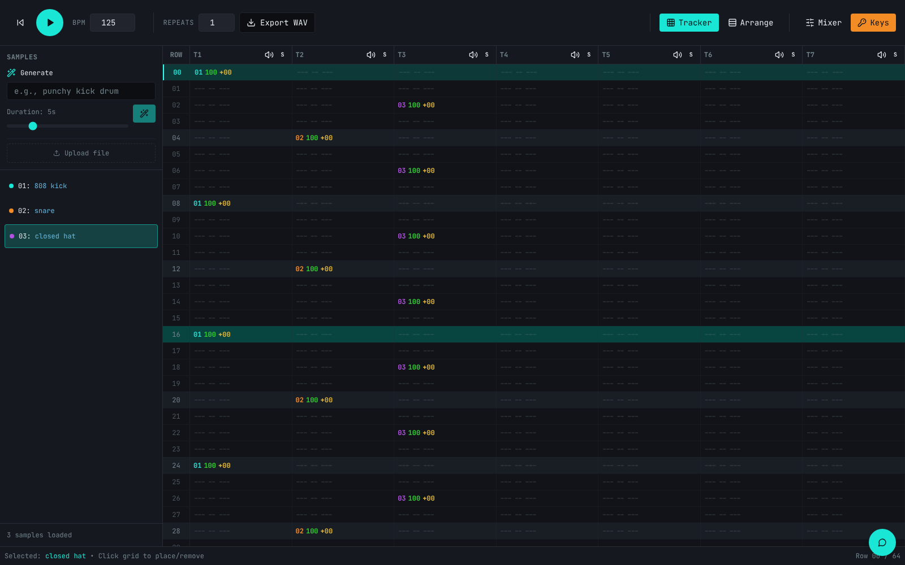

# Sample Groove Craft

A browser tracker DAW where every sample is generated by Stable Audio 3 from a text prompt, and an AI assistant builds and edits the pattern for you.



## Try it

**Hosted:** https://maxfieldhulkersai.github.io/Sample-tracker/

Click **Keys** in the top bar and paste your own keys. Both stay in your browser's localStorage and go only to the provider they belong to.

- **Stability API key** (required): generates every sample. Get one at https://platform.stability.ai/account/keys.
- **Google AI (Gemini) key** (optional): powers "generate a song" and the chat assistant. Get one at https://aistudio.google.com/apikey. Without it you can still generate samples one at a time and sequence them by hand.

**Local:**

```
npm install
npm run dev
```

Open http://localhost:8080. No env file is needed; the app runs in direct mode and asks for keys in the UI.

**Server mode (optional):** if you would rather keep the provider keys off the client, deploy the three functions in `supabase/functions` to your own Supabase project, set `STABILITY_API_KEY` and `GEMINI_API_KEY` as function secrets, and build with `VITE_SUPABASE_URL` and `VITE_SUPABASE_PUBLISHABLE_KEY` set (see `.env.example`). The app detects the Supabase config at build time and routes all three calls through the functions instead.

## What it does

A classic tracker grid: 64 rows, 7 tracks, 4 rows per beat, with a tracker view and an arrange view. Type a prompt like "punchy 808 kick" in the sample browser, set a length of 1 to 22 seconds, and a sample lands in your library a few seconds later; you can also drop your own audio files in. Click cells to place samples, set per-note volume and pitch (−24 to +24 semitones), mute and solo tracks, and open the mixer for track faders and sidechain ducking (any track can duck to any other). The chat assistant sees the whole project state and acts on it: ask for "a driving techno beat at 128 BPM" and it plans the samples, generates them, sets the tempo and places the notes; ask it to "add hats on every off-beat in the selection" and it edits only the selected region. Every assistant change can be undone in one click. Export the loop as a WAV with as many repeats as you want.

## How it was built

React 18, TypeScript, Vite and shadcn/ui, started in Lovable and then taken standalone. All playback is Web Audio: samples are decoded into AudioBuffers, the sequencer schedules notes from a row clock derived from the BPM, pitch is a playbackRate change, ducking is a gain envelope keyed off the source track's hits, and WAV export renders the pattern through an OfflineAudioContext. Generation has two modes behind one `src/lib/backend.ts` interface. Direct mode (the hosted demo) calls api.stability.ai and the Gemini API straight from the browser with keys from the Keys dialog; both providers allow cross-origin requests. Server mode routes the same calls through three Supabase edge functions that hold the keys as secrets. The prompts, the Stable Audio client and the Gemini client live once in `supabase/functions/_shared` and are imported by both the browser and the functions, so the two modes cannot drift. About 4,300 lines outside the UI kit. MIT licensed.

## How it uses Stable Audio

- **Text to Audio** (`POST /v2beta/audio/stable-audio/text-to-audio`): generates every sample. One call per sample with `model=stable-audio-3`, the prompt, `duration` 1 to 22 s (up to 190 s for a hand-typed prompt), and `output_format=mp3`. Melodic requests get the current BPM and key appended to the prompt ("..., 125 BPM in the key of C minor, seamless loop, consistent tempo, single musical phrase") so loops sit on the grid. The response is a 202 with an id; the client polls `GET /v2beta/audio/results/{id}` every 1.5 s until it gets a 200 with the audio bytes, with a backoff retry on 429. The song planner makes two to six of these calls per song, one per sample in the plan.

Model: `stable-audio-3`

The other provider is Google Gemini (`gemini-2.5-flash`), used for two things: turning a song description into a JSON plan of samples and note positions, and the chat assistant, which replies with JSON action blocks (`setNotes`, `generateSample`, `setDucking`, and so on) that the app executes.

## Project structure

| Path | Role |
| --- | --- |
| `src/components/tracker/TrackerDAW.tsx` | Top-level state: samples, pattern, transport, generate-sample and generate-song handlers. |
| `src/components/tracker/TrackerGrid.tsx`, `TrackView.tsx` | The tracker grid and the arrange view, with cell selection. |
| `src/components/tracker/TrackerChat.tsx` | The assistant panel; sends the project state with each message and executes the actions that come back. |
| `src/components/tracker/SampleBrowser.tsx`, `Mixer.tsx`, `TransportControls.tsx` | Sample library and prompt box, mixer with ducking, play/stop/BPM/export. |
| `src/components/tracker/SettingsDialog.tsx` | The Keys dialog. |
| `src/lib/audioEngine.ts` | Web Audio sequencer, sample loading, pitch, ducking, WAV export. |
| `src/lib/backend.ts` | Picks server or direct mode and exposes `generateAudio`, `generateSong`, `trackerChat`. The Stability calls live behind this file. |
| `src/lib/keys.ts` | localStorage storage for the two keys. |
| `supabase/functions/_shared/stability.ts` | Stable Audio 3 client: submit, poll, retry. |
| `supabase/functions/_shared/gemini.ts` | Gemini chat client. |
| `supabase/functions/_shared/prompts.ts` | The song planner and assistant system prompts, and the action parser. |
| `supabase/functions/_shared/song.ts` | Plan a song, then render each sample. |
| `supabase/functions/generate-audio`, `generate-song`, `tracker-chat` | The three edge functions for server mode, thin wrappers over the shared code. |
| `.github/workflows/pages.yml` | Builds with Vite and publishes `dist/` to GitHub Pages on push to `main`. |
| `docs/screenshot.png` | The image at the top of this README. |

## License

MIT, see [LICENSE](LICENSE).
